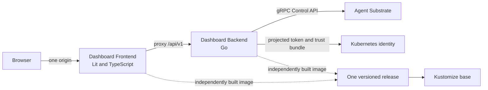

# Agent Substrate Dashboard architecture

## Goal

Build a standalone dashboard that can be added to an Agent Substrate implementation without depending on its agent client, model provider, or application protocol. The original `always-on-agent` dashboard supplies the visual reference, not reusable source or domain assumptions.

The first integration target is `herdr-agent-substrate-on-kind`. Herdr remains outside the dashboard boundary.

## System shape



The frontend is the only browser-facing service. The backend stays cluster-internal. Both components are built and deployed independently but are published under one release version.

## Product boundary

The dashboard includes:

- one configured atespace and one selected worker pool per backend instance;
- actor lifecycle state and explicit Resume or Suspend operations;
- worker state, assignments, resource capacity, and allocation;
- state transitions observed since the backend started;
- operations submitted through the dashboard since the backend started;
- Fleet Ratio and Observed Density derived by the backend;
- Control API connectivity as observed by the backend.

The dashboard excludes:

- Herdr clients, sessions, machines, and agent state;
- OpenClaw, messaging channels, and model providers;
- application health probes and workload generation;
- persisted audit history and external telemetry in v1;
- infrastructure cost or savings estimates;
- claims about whole-control-plane or router health;
- application authentication in v1.

## Backend responsibilities

The Go backend imports the generated client for one pinned Agent Substrate version and calls the gRPC `Control` API directly. It never shells out to `kubectl` or `kubectl-ate`.

It:

1. polls actors, workers, and worker assignments on a configurable interval;
2. follows every native pagination token before constructing a snapshot;
3. filters the configured atespace and selected worker pool;
4. normalizes all current actor and worker states, retaining an Unknown fallback;
5. joins zero-to-many actor assignments to workers;
6. derives fleet counts, Fleet Ratio, Observed Density, and resource summaries;
7. compares observations to infer lifecycle transitions;
8. retains bounded transitions, operations, and density samples in memory;
9. executes bounded-parallel, non-atomic bulk Resume or Suspend operations;
10. returns one result for every actor targeted by a bulk operation;
11. exposes only allowlisted dashboard fields, never raw protobuf messages;
12. advertises API version, component version, capabilities, observation time, sample age, and truncation.

The backend defaults to observe-only. Operations require explicit enablement and an AccessPolicy granted by the consuming deployment. It never provisions or widens its own authority.

## HTTP contract

OpenAPI is the source of truth. It generates Go transport types and TypeScript client types.

Initial endpoints:

| Method | Path | Purpose |
|---|---|---|
| `GET` | `/api/v1/meta` | API version, component version, capabilities, and supported Substrate version |
| `GET` | `/api/v1/snapshot` | One normalized Dashboard Snapshot |
| `POST` | `/api/v1/operations/resume` | Resume explicitly named actors and return per-actor results |
| `POST` | `/api/v1/operations/suspend` | Suspend explicitly named actors and return per-actor results |
| `GET` | `/healthz` | Process liveness |
| `GET` | `/readyz` | Configuration loaded, authentication working, and an initial observation available |

The frontend polls the snapshot endpoint every two seconds with one abortable, non-overlapping request. A failed request leaves the last successful snapshot visible and marks it stale. Unsupported API versions produce a dedicated incompatibility screen.

The snapshot is sized for up to 500 actors and 100 workers. Configurable presentation limits include explicit truncation metadata. Larger fleets require a later server-side query and virtualization design.

## Frontend responsibilities

`<substrate-dashboard>` owns:

- API compatibility checking;
- the polling lifecycle and stale-state calculation;
- the current Dashboard Snapshot;
- actor selection;
- operation requests and their results.

Every visible card is a dedicated semantic Lit element. Cards receive typed properties, emit semantic custom events, and perform no network requests.

| Element | Responsibility |
|---|---|
| `<actor-status-card>` | Total actors and counts for every present lifecycle state |
| `<control-api-card>` | Connected, Stale, or Unavailable backend-to-Control-API state |
| `<transition-count-card>` | Resume and suspend transitions observed since backend start |
| `<worker-occupancy-card>` | Occupied workers, selected workers, and assignment summary |
| `<operational-efficiency-card>` | Fleet Ratio, Observed Density, window age, and resource detail |
| `<actor-lifecycle-card>` | Observable lifecycle diagram including failure and maintenance branches |
| `<worker-map-card>` | Worker state, zero-to-many assignments, capacity, and allocation |
| `<actor-fleet-card>` | Actor state, worker assignment, and explicit multi-selection |
| `<actor-timeline-card>` | Observed Transitions since backend start |
| `<operation-stream-card>` | Dashboard Operations and per-actor outcomes since backend start |

Each element uses Shadow DOM. Shared CSS custom properties provide colors, spacing, typography, borders, and motion settings. The shell uses fluid CSS Grid; cards use container queries so they respond to allocated space rather than page width.

The 1280×1080 screenshot is the Reference Viewport, not a fixed canvas. Accessibility takes precedence over literal pixel matching: state always has a text signal, actor selection is keyboard-operable, focus is visible, and reduced-motion preferences disable pulses.

## Metrics

- **Fleet Ratio** = current managed actors / selected workers.
- **Observed Density** = managed actors at the moment of peak occupied-worker demand / occupied workers at that moment.
- The density window defaults to 15 minutes and is configurable.
- Each snapshot reports the configured window and available sample age.
- Worker resource capacity and allocation remain supporting dimensions; they are not collapsed into a cost or savings claim.

## Security and deployment

- The dashboard is a trusted-network operator surface in v1.
- The backend uses an in-cluster projected ServiceAccount token and mounted Substrate trust bundle.
- Observation is enabled by default; operations are opt-in.
- Consuming implementations own ServiceAccount policy and atespace AccessPolicy grants.
- The Kustomize base supplies the two Deployments, Services, ServiceAccount, and configuration structure.
- Consumer overlays pin image digests and configure endpoints, scope, exposure, and permissions.
- Release images support `linux/amd64` and `linux/arm64`.

## Proposed repository layout

```text
agent-substrate-dashboard/
├── api/
│   └── openapi.yaml
├── backend/
│   ├── cmd/dashboard-backend/
│   ├── internal/control/
│   ├── internal/collector/
│   ├── internal/dashboard/
│   ├── internal/httpapi/
│   └── Dockerfile
├── frontend/
│   ├── src/components/
│   ├── src/generated/
│   ├── src/fixtures/
│   ├── src/styles/
│   ├── src/substrate-dashboard.ts
│   ├── preview/
│   └── Dockerfile
├── deploy/
│   └── kustomize/base/
├── docs/adr/
├── GLOSSARY.md
├── LICENSE
└── README.md
```

Generated files are outputs, not the place for domain logic. The backend packages separate Control API access, observation, domain calculation, and HTTP transport. The frontend fixture gallery renders each card independently without a second component framework.

## Verification

- OpenAPI generation must leave the worktree clean.
- Backend tests use an in-process fake Control gRPC service.
- Contract tests cover pagination, all lifecycle states, authentication failures, truncation, density calculations, and partial bulk outcomes.
- Frontend tests use stable generated-client fixtures.
- Playwright captures every card and the full Reference Viewport in idle, resuming, saturated, empty, stale, crashed, truncated, observe-only, partial-failure, and version-mismatch states.
- A smaller end-to-end suite deploys the released pair to `herdr-agent-substrate-on-kind` and verifies real ServiceAccount authentication, observations, Resume, and Suspend.
